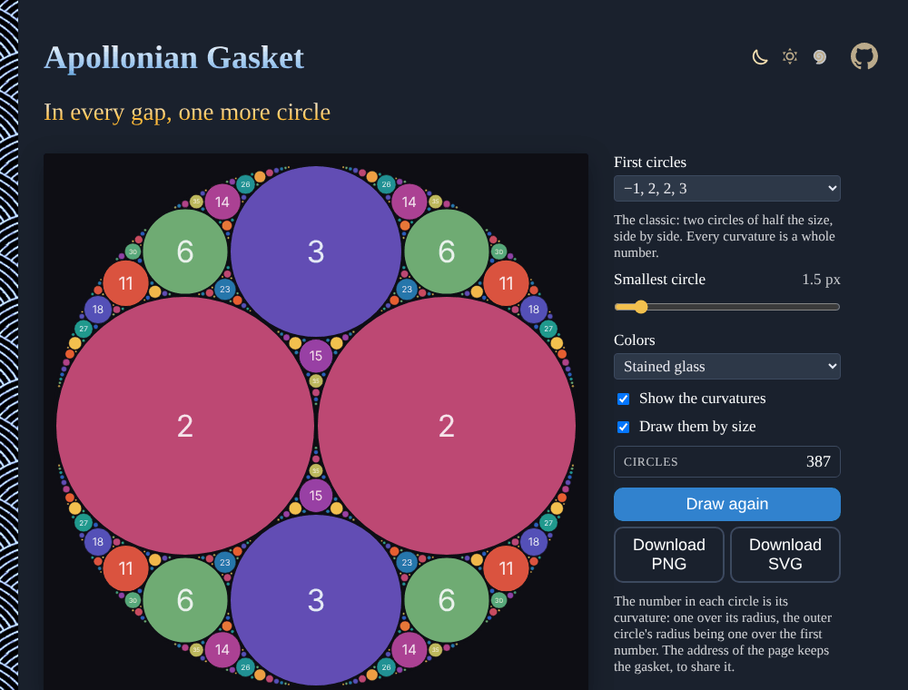

# Apollonian-Gasket

Circles packed into circles, forever: in every gap between three touching circles fits a fourth, given by Descartes' circle theorem. Start from whole-number curvatures and every circle has one too. Download the gasket as SVG or PNG. No sign-up, no libraries.

**[▶ Pack some circles](https://evoluteur.github.io/apollonian-gasket/)**

## Features

| Control | What it does |
| ------- | ------------ |
| **First circles** | Eight integral gaskets, named by their first four curvatures (−1, 2, 2, 3 is the classic), or **Free**: choose the sizes of the first two circles. |
| **Smallest circle** | Where to stop, in pixels. |
| **Colors** | Stained glass, Ocean, Sunset, Ink on paper, Black and gold, Blueprint. |
| **Show the curvatures** | The whole number in each circle (integral gaskets). |
| **Draw them by size** | The circles appear from the biggest to the smallest. |
| **Download SVG** | Vector, one `<circle>` per circle. |
| **Download PNG** | The picture. |

The address of the page keeps the gasket, to share it.

## How it is built

Each circle is stored as its curvature *k* (one over its radius, negative for the outer circle) and *k* times its center. Descartes' theorem, in its complex form, gives the fourth circle touching three; after that, every new circle comes from a simple reflection: in a quadruple of touching circles, the other circle touching three of them is

`k' = 2 (k1 + k2 + k3) − k4`, and the same for *k* times the center.

It is linear, so whole numbers stay whole numbers: that is why an integral gasket stays integral down to the smallest circle. The gasket is built recursively, until the circles are smaller than the chosen size.

Plain HTML, CSS and JavaScript, with no dependencies and no build step:

| File | Content |
| ---- | ------- |
| [index.html](index.html) | the page and its controls |
| [js/gasket.js](js/gasket.js) | the circles, the drawing and the SVG export |
| [css/gasket.css](css/gasket.css) | the styles of the page |
| [css/themes](css/themes) | the three color themes |

To run it locally, just open `index.html` in a browser. The three color themes (dark, light and blue) are shared with my other projects (copied from [omg-themes](https://github.com/evoluteur/omg-themes)).

## A little history

Apollonius of Perga posed the problem of the circles touching three given circles around 200 BC. René Descartes gave the relation between the curvatures of four touching circles in a letter of 1643; Frederick Soddy rediscovered it in 1936 and published it as a poem, *The Kiss Precise*, in *Nature*.

## Related projects

- [Sacred Geometry](https://evoluteur.github.io/sacred-geometry/) ([code](https://github.com/evoluteur/sacred-geometry))
- [Rose Window Maker](https://evoluteur.github.io/rose-window-maker/) ([code](https://github.com/evoluteur/rose-window-maker))
- [Mandelbrot and Julia](https://evoluteur.github.io/mandelbrot-julia/) ([code](https://github.com/evoluteur/mandelbrot-julia))

For more patterns grown from a few rules, see [Generative Art](https://evoluteur.github.io/generative-art.html).

## License

Apollonian Gasket is open source under the [MIT license](LICENSE).

Had fun with the app? [Buy me a coffee by becoming a sponsor](https://github.com/sponsors/evoluteur).

(c) 2026 [Olivier Giulieri](https://evoluteur.github.io/)
